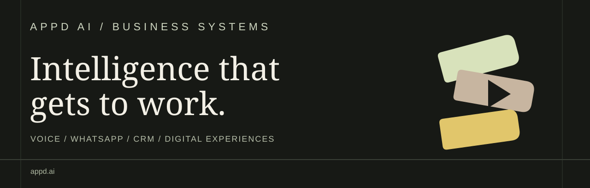

 

**Business automation · AI voice agents · WhatsApp experiences · Connected customer journeys**

We build practical systems that help businesses respond faster, reduce repetitive work and convert more opportunities into measurable outcomes.

[**Explore AppD AI**](https://appd.ai) &nbsp;·&nbsp; [**Discuss a project**](mailto:ambrish@appd.ai) &nbsp;·&nbsp; [**View capabilities**](#what-we-build)

 

## What we build

| Capability | Business application |
| :--- | :--- |
| **AI voice agents** | Inbound enquiries, lead qualification, follow-ups, appointment coordination and customer support |
| **WhatsApp automation** | Conversational journeys, guided onboarding, service updates and sales follow-through |
| **CRM & workflow integration** | Connected lead records, routing, pipeline visibility and operational reporting |
| **AI-enabled business systems** | Revenue diagnostics, information retrieval and assisted operations |
| **Interactive brand experiences** | Gesture-led digital displays, QR activation and measurable audience engagement |
| **Digital solutions** | Websites, portals, dashboards and business-specific product development |

## Selected solutions

<table>
<tr>
<td width="50%" valign="top">

### 01 / Voice intelligence
Multilingual business conversations for qualification, support and follow-through.

**Focus:** Response speed, lead handling and human handoff.

[View voice-agent collateral](https://drive.google.com/file/d/12fmO-zPJ7SMPCdqssIkMXCZYgcugZbVc/view)

</td>
<td width="50%" valign="top">

### 02 / Connected messaging
WhatsApp journeys that connect customer intent to the next operational action.

**Focus:** Enquiries, activation, reminders and CRM continuity.

[View WhatsApp collateral](https://drive.google.com/file/d/1Mmmj7ZGkcwD752QrD5PmP7roSpyqSOyW/view)

</td>
</tr>
<tr>
<td width="50%" valign="top">

### 03 / GlidePath
Interactive digital-out-of-home experiences connecting physical attention to measurable customer interaction.

**Focus:** Engagement, QR journeys and branded experiences.

[View GlidePath product sheet](https://drive.google.com/file/d/1GwPkedDxxF_jCOWmQeP3oKUFj_JCMKoJ/view)

</td>
<td width="50%" valign="top">

### 04 / Operational intelligence
Connected dashboards and decision workflows built around actual operating needs.

**Focus:** Visibility, consistency and reduced manual coordination.

[Explore solution portfolio](https://drive.google.com/file/d/1wi_AnPkisN_oDNkB1H-_M24FdfmSmxIh/view)

</td>
</tr>
</table>

## How we approach delivery

**Discover the bottleneck** → **Define the measurable result** → **Build the workflow** → **Connect the systems** → **Measure and improve**

Our work is guided by business outcomes rather than a predetermined technology stack.

## Areas of work

**Education & training** · **Retail & commerce** · **Real estate** · **Professional services** · **Hospitality** · **Public-facing services**

## About

**Aambrish Trikha** works across growth strategy, business automation and digital product execution at **AppD AI**.

This GitHub space shares selected technical work and represents AppD AI's wider solution portfolio. Client implementations, sensitive integrations and proprietary materials are not published here.

---

### Build something useful.

**A clear commercial problem. A connected system. A result you can measure.**

[Website](https://appd.ai) &nbsp;·&nbsp; [Email](mailto:ambrish@appd.ai) &nbsp;·&nbsp; [GitHub](https://github.com/aambrishtrikha-commits)

© 2026 AppD AI. Brand and project assets remain with their respective owners.

